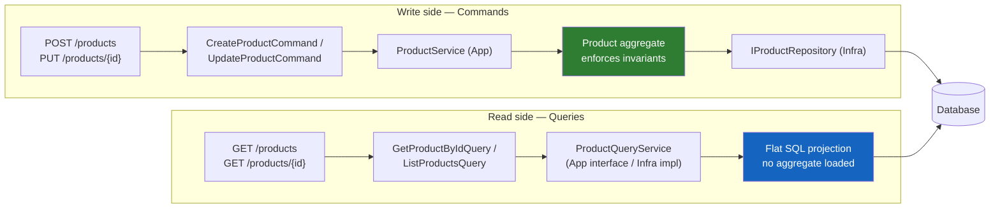
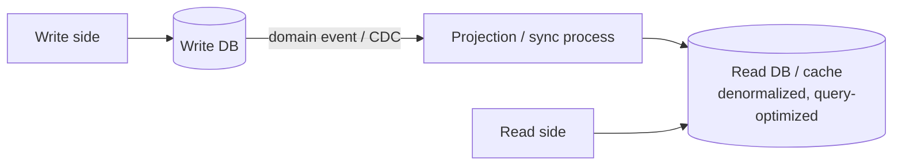

# CQRS — Command Query Responsibility Segregation

**The core idea, in one sentence:** stop using the same model and the same code path for both *changing* data and *reading* data — writes need consistency and invariant-enforcement, reads need speed and shape-flexibility, and forcing one model to serve both pulls it in two directions at once.

We've actually already built half of this without naming it — `CreateProductCommand` and `UpdateProductCommand` *are* the "C" in CQRS. This doc covers the "Q" we haven't built yet, and when it's worth the extra split.

---

## The split, applied to `ProductCatalog`

| | Write side (Commands) | Read side (Queries) |
|---|---|---|
| Triggered by | `POST /products`, `PUT /products/{id}` | `GET /products`, `GET /products/{id}` |
| Input shape | `CreateProductCommand`, `UpdateProductCommand` | `GetProductByIdQuery`, `ListProductsQuery` |
| Goes through | `ProductService` → `Product` aggregate (full invariant checks) | `ProductQueryService` → flat SQL projection, **no aggregate loaded** |
| Output shape | `Product` (the rich domain object) | `ProductSummary` (a plain, flat read record) |
| Optimized for | Correctness — can't persist an invalid state | Speed — `.AsNoTracking()`, exactly the columns the UI needs |

The key realization: **a read never needs to protect an invariant**, because it isn't changing anything. Loading the full `Product` aggregate — with its owned `Variants` collection, its private setters, its validation methods — just to show a product list is pure overhead. The read side can go around all of that and talk to the database directly.

---

## What the read side looks like

```csharp
// App.Models/Queries/GetProductByIdQuery.cs
public sealed record GetProductByIdQuery(Guid Id);

// App.Models/Queries/ProductSummary.cs — flat, NOT the Product aggregate
public sealed record ProductSummary(
    Guid Id, string Sku, string Name, decimal Price, string Status, int VariantCount);
```

```csharp
// App/Queries/Interfaces/IProductQueryService.cs — contract lives in App, same as IProductRepository
public interface IProductQueryService
{
    Task<ProductSummary?> GetByIdAsync(GetProductByIdQuery query, CancellationToken cancellationToken);
    Task<IReadOnlyCollection<ProductSummary>> ListAsync(CancellationToken cancellationToken);
}
```

```csharp
// Infra/Queries/ProductQueryService.cs — talks to the DbContext directly, bypasses the aggregate entirely
internal sealed class ProductQueryService(ProductCatalogDbContext dbContext) : IProductQueryService
{
    public async Task<ProductSummary?> GetByIdAsync(GetProductByIdQuery query, CancellationToken cancellationToken) =>
        await dbContext.Products
            .AsNoTracking()
            .Where(p => p.Id == query.Id)
            .Select(p => new ProductSummary(p.Id, p.Sku, p.Name, p.Price, p.Status.ToString(), p.Variants.Count))
            .FirstOrDefaultAsync(cancellationToken);

    public async Task<IReadOnlyCollection<ProductSummary>> ListAsync(CancellationToken cancellationToken) =>
        await dbContext.Products
            .AsNoTracking()
            .Select(p => new ProductSummary(p.Id, p.Sku, p.Name, p.Price, p.Status.ToString(), p.Variants.Count))
            .ToListAsync(cancellationToken);
}
```

Same split as `IProductRepository`/`ProductRepository`: interface in `App`, implementation in `Infra` — the query service is still an Infra concern because `ProductCatalogDbContext` is Infra-only.

---

## Flow diagram — both sides, same database (this is what `ProductCatalog` actually needs)



This is sometimes called **"CQRS-lite"**: two separate code paths, two separate models, but still **one database**. No event sourcing, no message bus, no eventual consistency to reason about. For a service this size, this is almost always as far as you need to go.

---

## A natural candidate we already built: `GetEnrichedProductAsync`

Back when we built the Abstract Factory example, `GetEnrichedProductAsync` (loads `Product`, resolves the Contoso/Fabrikam client pair, merges in image + promo data) went into `ProductService` — the *write* service. But look at what it actually does: it never mutates anything, it only reads and composes. By CQRS's own definition, **that method was a query wearing a write-service's clothes.** The honest refactor is to move it to the read side:

```csharp
// App.Models/Queries/GetEnrichedProductQuery.cs
public sealed record GetEnrichedProductQuery(Guid Id);

// App/Queries/Interfaces/IEnrichedProductQueryService.cs
public interface IEnrichedProductQueryService
{
    Task<EnrichedProduct> HandleAsync(GetEnrichedProductQuery query, CancellationToken cancellationToken);
}
```

`EnrichedProductQueryService` would still use `IProductRepository` (to get the full `Product`, since it needs `Sku` and other real fields, not just the flat `ProductSummary`) plus `IEnrichmentProviderFactory` — but it's registered and named as a *query*, not folded into the command-handling `ProductService`. Nothing about the Factory/Abstract Factory work changes; only which service class owns the call.

---

## When NOT to bother (this is a YAGNI call, not a default)

Don't introduce the query split on day one. Start with a single `ProductService` that has both `GetByIdAsync` and `CreateProductAsync` — that's perfectly fine for a small service, and it's exactly what KISS/YAGNI argues for. Reach for the Command/Query split only when one of these becomes true:

- The read shape genuinely diverges from the write shape (a list view needs 5 flattened fields; the aggregate carries 20 plus a child collection).
- Loading the full aggregate for a read becomes a measurable cost (EF materializing `Variants`, `Money` conversions, etc., just to render a product grid).
- A read operation composes multiple sources (exactly what `GetEnrichedProductAsync` does) and conceptually doesn't belong next to mutation logic.

If none of those apply yet, two methods on one `ProductService` is the right amount of structure — don't build the query side preemptively.

---

## Going further — "full" CQRS (optional, not needed here)

The term CQRS is sometimes used for a much heavier setup: a **separate read-optimized store** (a denormalized read DB, a cache, or a search index), kept in sync with the write DB asynchronously via domain events or change-data-capture. This is usually paired with **event sourcing** and is a real answer to genuine read/write scaling mismatches — but it introduces eventual consistency (a read might briefly show stale data right after a write) and a whole synchronization pipeline to operate and debug.



**Skip this for `ProductCatalog`.** Nothing about this project's scale or read/write load justifies the added moving parts. The "CQRS-lite, same database" version above is the correct amount of pattern for what we're building — this section exists so you know the heavier version exists and why we're deliberately not reaching for it.
