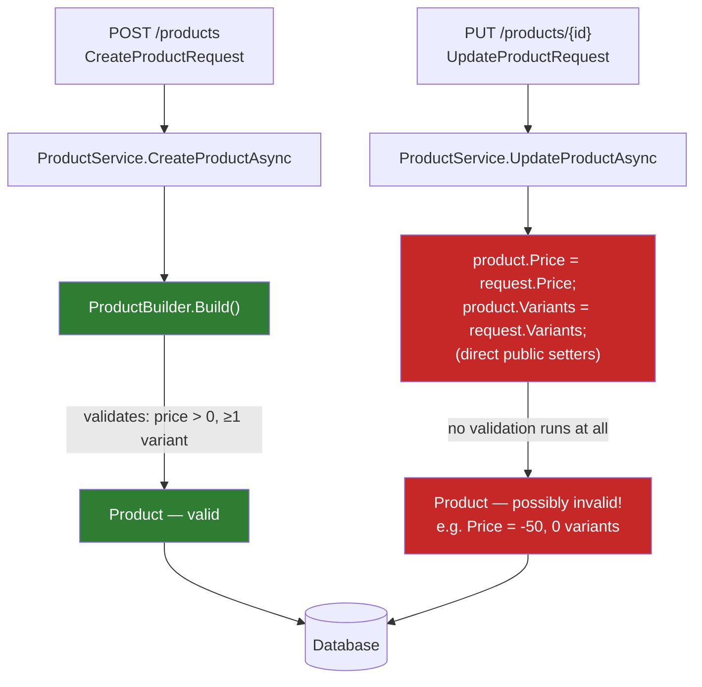
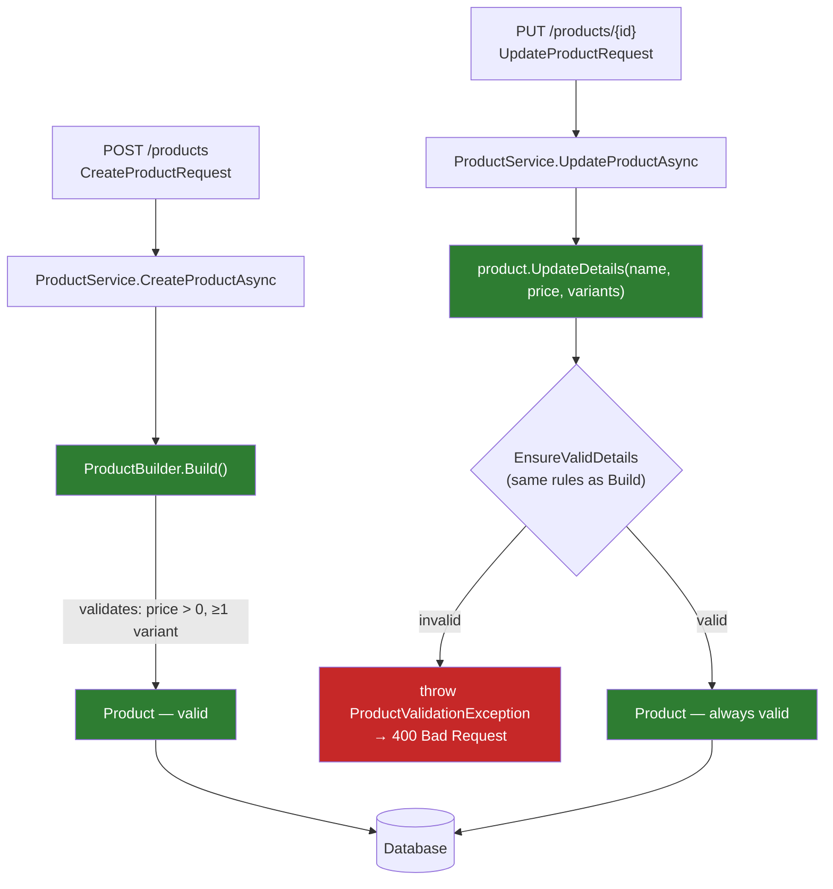

# Rich Domain Model vs. Anemic Model — with Builder

Both approaches can use `ProductBuilder` to safely construct a brand-new `Product`. They diverge the moment the product already exists and needs to **change** — that's the only place this comparison matters.

---

## Anemic Model — Builder protects creation, nothing protects update



**The gap:** `ProductBuilder.Build()` only runs on the **create** path. The moment `Product` has public setters, every *other* code path — the update endpoint today, a bulk-import tool next year, a background job nobody's written yet — can mutate it directly and skip validation entirely. The Builder's protection doesn't travel with the object; it only applies at the one call site that happens to use it.

```csharp
// Anemic Product — the setters are the hole in the wall
public sealed class Product
{
    public Guid Id { get; set; }
    public string Name { get; set; }
    public decimal Price { get; set; }
    public List<ProductVariant> Variants { get; set; }
}

// Update path — compiles fine, ships a broken product
product.Price = request.Price;          // could be -50
product.Variants = request.Variants;    // could be empty
await dbContext.SaveChangesAsync();     // no one objects
```

---

## Rich Model — the same rules, enforced everywhere, forever



**Why it holds:** `Build()` and `UpdateDetails()` both call the *same* `EnsureValidDetails` rule set. There is no second door — every path that changes a `Product`, now or in the future, has to go through a method that checks the rule before it takes effect.

```csharp
public sealed class Product
{
    public string Name { get; private set; }
    public Money Price { get; private set; }
    private readonly List<ProductVariant> _variants = [];
    public IReadOnlyCollection<ProductVariant> Variants => _variants;

    public void UpdateDetails(string name, Money price, List<ProductVariant> variants)
    {
        EnsureValidDetails(name, price, variants);   // same rule Build() uses

        Name = name;
        Price = price;
        _variants.Clear();
        _variants.AddRange(variants);
    }

    internal static void EnsureValidDetails(string? name, Money? price, IReadOnlyCollection<ProductVariant> variants)
    {
        if (string.IsNullOrWhiteSpace(name)) throw new ProductValidationException("Name is required.");
        if (price is null || price.Amount <= 0) throw new ProductValidationException("Price must be greater than zero.");
        if (variants.Count == 0) throw new ProductValidationException("At least one variant is required.");
    }
}
```

No public setters exist to bypass — `Name`, `Price`, and `Variants` can only change by going through `UpdateDetails`, which can't let an invalid value through.

---

## Side by side

| | Anemic + Builder | Rich + Builder |
|---|---|---|
| Create path protected? | ✅ yes — `Build()` validates | ✅ yes — `Build()` validates |
| Update path protected? | ❌ no — public setters bypass everything | ✅ yes — `UpdateDetails()` reuses the same rule |
| Future/unknown call sites protected? | ❌ no — anyone with a setter can break it | ✅ yes — no other way in exists |
| Where does "can't apply promo with 0% discount" live? | Nowhere, or duplicated in every caller | One method (`ApplyPromotion`), called once |
| Where does "can't reactivate a Discontinued product" live? | Can't be expressed — no "current state" to check | `Activate()` checks `Status` on `this` before changing it |

---

## This isn't theoretical — it's the bug that started this whole conversation

The Wishlist `AddProductToWishlist` 500 error happened for exactly this reason: `ProductListItem` was anemic (plain `{ get; set; }` properties), so `ProductListService.AddProductAsync` could build one with `ProductListId = Guid.Empty` and nothing in the class objected — the bug only surfaced three layers downstream as a bare SQL foreign-key exception. A rich `ProductListItem` with a guarded constructor or builder would have made that state impossible to construct in the first place.
